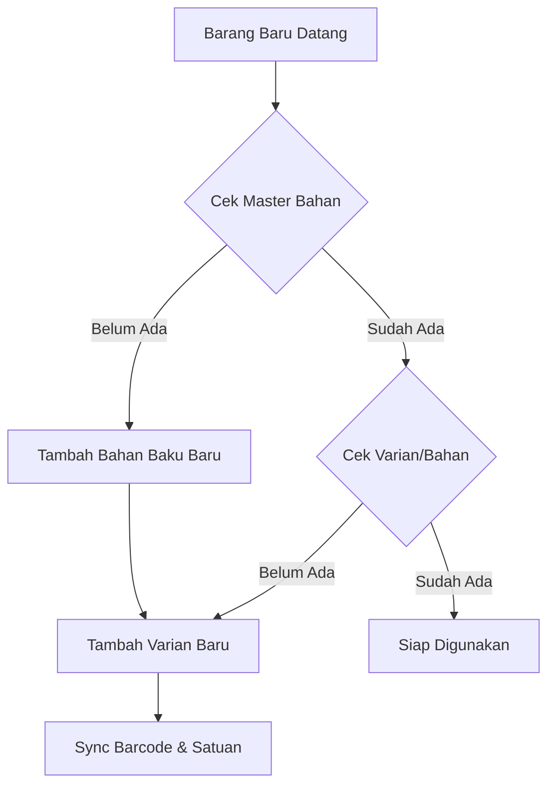
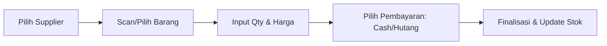
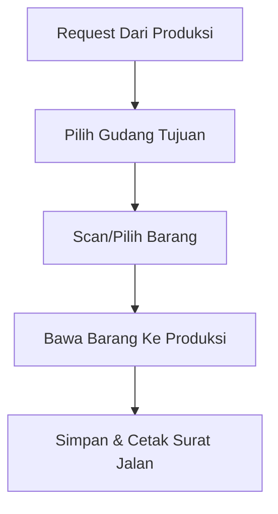
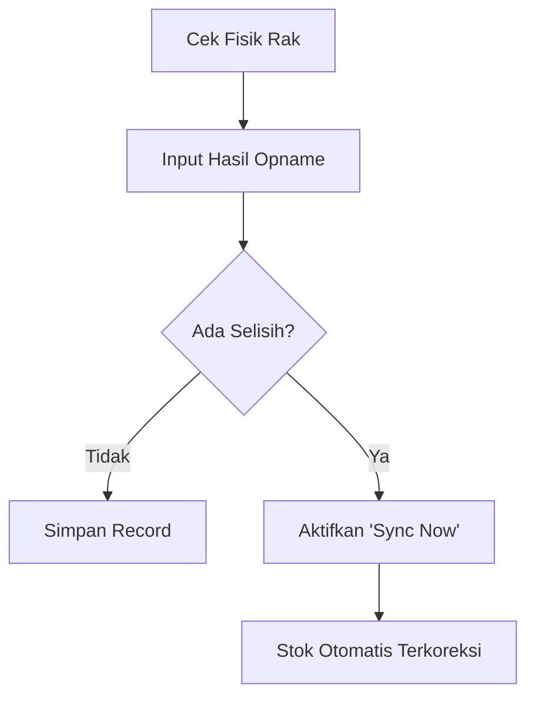

# Panduan Operasional Gudang (WMS) - TGM ERP

Dokumen ini berisi langkah kerja standar (SOP) untuk Admin Gudang dalam mengelola stok material secara akurat dan efisien menggunakan modul Warehouse Management System (WMS).

---

## 🏗️ 1. Persiapan Awal: Setup Master Data

*Hanya dilakukan saat ada barang baru atau perubahan spek material.*

**Langkah Kerja:**

1. **Menu Master Material**: Pastikan setiap barang unik memiliki **Barcode** dan **Satuan Gudang** yang benar.
2. **Konversi Satuan**: Gunakan fitur konversi jika barang dibeli dalam satuan besar (misal: Roll) tapi dikeluarkan dalam satuan kecil (misal: Meter).
3. **Sync Barcode**: Gunakan barcode fisik atau biarkan sistem men-generate otomatis untuk pelacakan batch.

---

## 📥 2. Penerimaan Barang (Purchase/In)

*Proses mencatat barang masuk dari Supplier ke Gudang Utama.*

**Langkah Kerja:**

1. **Input Pembelian**: Pilih supplier dan masukkan nomor faktur fisik.
2. **Add To Cart**: Tambahkan semua item yang diterima ke keranjang pembelian.
3. **Verifikasi Harga**: Pastikan harga beli sesuai untuk akurasi laporan keuangan.
4. **Finalisasi**: Klik "Save" untuk memperbarui **Kartu Stok** dan saldo hutang supplier secara otomatis.

---

## 📤 3. Distribusi Ke Produksi (Dispatch/Out)

*Proses pengiriman material dari Gudang Utama ke lantai Produksi.*

**Langkah Kerja:**

1. **Menu Dispatch**: Pilih gudang produksi tujuan (Produksi 1, 2, atau Cabang).
2. **Scan Barang**: Masukkan material yang akan dikirim (sistem akan mengecek ketersediaan stok).
3. **Proses Keluar**: Klik "Finalize". Stok **Gudang Utama (-) menurup** dan stok **Gudang Tujuan (+) bertambah**.

---

## 🔍 4. Audit & Pengendalian (Stock Opname)

*Dilakukan berkala (mingguan/bulanan) untuk memastikan stok fisik = stok sistem.*

**Langkah Kerja:**

1. **Menu Opname**: Pilih item yang akan diaudit.
2. **Input Real**: Masukkan jumlah fisik yang benar-benar ada di rak.
3. **Sinkronisasi**: Jika ditemukan selisih, gunakan opsi **"Sync Now"** untuk memaksa data sistem mengikuti data fisik (mencatat log koreksi).
4. **Kartu Stok**: Pantau riwayat perubahan di menu **Ledger** untuk melacak siapa yang mengubah stok dan kapan.

---

## 🛡️ Tips Keamanan & Akurasi

- **Always Scan**: Gunakan Scanner Barcode setiap kali melakukan transaksi untuk menghindari salah pilih varian.
- **Check Ledger**: Jika stok terasa tidak wajar, lihat **Kartu Stok (Ledger)**. Setiap pergerakan (Masuk, Keluar, Opname) terekam jelas.
- **Low Stock Alerts**: Perhatikan warna indikator pada Dashboard. Barang merah berarti sudah di bawah batas minimum dan harus segera di-order.
